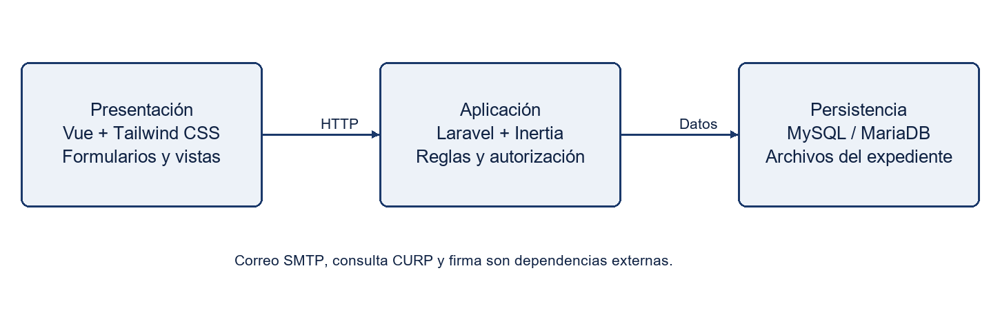
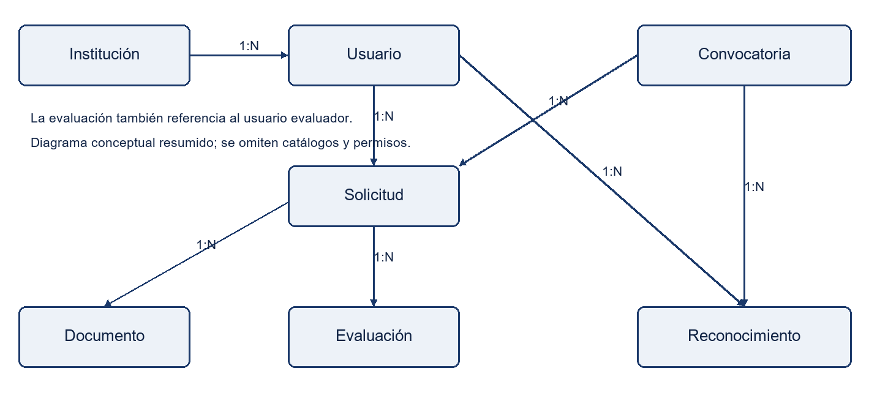
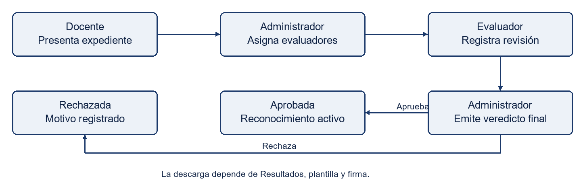

# Reporte de residencia profesional del Sistema EDD

Proyecto: Plataforma web para la gestión del Programa de Estímulos al Desempeño del Personal Docente del TecNM.

Institución de procedencia: Instituto Tecnológico Superior de Tepeaca.

Organización receptora: Centro Nacional de Investigación y Desarrollo Tecnológico, Tecnológico Nacional de México.

Autores: María Guadalupe García García y Óscar Crisanto Garnica.

Asesores: Dr. Vitervo López Caballero y Johan Sinoe de Jesús Torres. La asignación de asesor interno y externo y el grado académico del segundo asesor requieren confirmación.

Carrera: Ingeniería en Tecnologías de la Información y Comunicaciones.

### AGRADECIMIENTOS

Se agradece al personal del Centro Nacional de Investigación y Desarrollo Tecnológico por el espacio institucional en el que se plantea el desarrollo de la plataforma, así como a los asesores responsables de orientar la residencia profesional. Su acompañamiento permite relacionar los conocimientos de ingeniería con las necesidades de gestión del Programa de Estímulos al Desempeño del Personal Docente.

Se reconoce la labor de las personas docentes, administrativas y evaluadoras que participan en el programa, cuyas responsabilidades constituyen la referencia para organizar los módulos y recorridos del sistema. La claridad de estas funciones es necesaria para desarrollar una herramienta que pueda apoyar la revisión y el seguimiento de expedientes.

La redacción definitiva de este apartado podrá complementarse con los agradecimientos personales que deseen expresar los autores. No se consignan colaboraciones específicas que no estén confirmadas en la documentación de residencia.

#### DATOS ACADÉMICOS POR COMPLETAR

- Números de control de ambos residentes.

- Fechas oficiales de inicio y término de la residencia y fecha de entrega.

- Identificación de cuál asesor es interno y cuál externo.

- Horas acreditadas, constancia de aceptación y carta de liberación.

### RESUMEN

El proyecto aborda una plataforma web para gestionar el Programa de Estímulos al Desempeño del Personal Docente del Tecnológico Nacional de México, en el contexto del CENIDET. Su alcance comprende siete módulos: portal público, autenticación y registro, roles, catálogos, reconocimientos, gestión de solicitudes y carga documental. La aplicación existente utiliza Vue.js, Inertia.js, Laravel y Tailwind CSS. Permite registrar institución, área y subárea, consultar datos mediante CURP, integrar expedientes PDF por vía corta o larga, asignar evaluadores y emitir un veredicto administrativo independiente de la revisión. El análisis relaciona los requerimientos del proyecto con el código disponible y los pendientes de aceptación. Se identifican reportes parciales por institución y estatus; falta completar los filtros por periodo, área y subárea y su correspondencia con la exportación. El reporte previo registra 18 pruebas y 174 comprobaciones satisfactorias, cuyo alcance no cubre todos los requerimientos. La firma documental y la consulta externa de CURP requieren validación operativa. El resultado es una base funcional y una especificación de adecuaciones, pruebas y documentación para preparar su aceptación institucional.

Palabras clave: desempeño docente, expediente digital, evaluación, aplicación web, control de acceso.

### ÍNDICE GENERAL

  - [AGRADECIMIENTOS](#agradecimientos)
    - [DATOS ACADÉMICOS POR COMPLETAR](#datos-académicos-por-completar)
  - [RESUMEN](#resumen)
  - [ÍNDICE GENERAL](#índice-general)
  - [ÍNDICE DE FIGURAS](#índice-de-figuras)
  - [ÍNDICE DE TABLAS](#índice-de-tablas)
- [CAPÍTULO I GENERALIDADES DEL PROYECTO](#capítulo-i-generalidades-del-proyecto)
  - [1.1 INTRODUCCIÓN](#11-introducción)
  - [1.2 DESCRIPCIÓN DE LA ORGANIZACIÓN Y DEL ÁREA DE TRABAJO](#12-descripción-de-la-organización-y-del-área-de-trabajo)
    - [1.2.1 Antecedentes históricos de la organización](#121-antecedentes-históricos-de-la-organización)
    - [1.2.2 Caracterización del área donde se generó el proyecto](#122-caracterización-del-área-donde-se-generó-el-proyecto)
  - [1.3 PROBLEMAS A RESOLVER PRIORIZADOS](#13-problemas-a-resolver-priorizados)
  - [1.4 OBJETIVOS](#14-objetivos)
    - [1.4.1 Objetivo general](#141-objetivo-general)
    - [1.4.2 Objetivos específicos](#142-objetivos-específicos)
  - [1.5 JUSTIFICACIÓN DE LA PROPUESTA](#15-justificación-de-la-propuesta)
- [CAPÍTULO II MARCO TEÓRICO](#capítulo-ii-marco-teórico)
  - [2.1 FUNDAMENTOS TEÓRICOS](#21-fundamentos-teóricos)
    - [2.1.1 Evaluación del desempeño docente y expediente digital](#211-evaluación-del-desempeño-docente-y-expediente-digital)
    - [2.1.2 Bases de datos relacionales e integridad](#212-bases-de-datos-relacionales-e-integridad)
    - [2.1.3 Arquitectura web y stack VILT](#213-arquitectura-web-y-stack-vilt)
    - [2.1.4 Control de acceso basado en roles](#214-control-de-acceso-basado-en-roles)
    - [2.1.5 Procesamiento asíncrono y notificaciones](#215-procesamiento-asíncrono-y-notificaciones)
    - [2.1.6 Firma de documentos y accesibilidad](#216-firma-de-documentos-y-accesibilidad)
- [CAPÍTULO III METODOLOGÍA](#capítulo-iii-metodología)
  - [3.1 ANÁLISIS Y REQUERIMIENTOS](#31-análisis-y-requerimientos)
    - [3.1.1 Casos de uso y reglas del proceso](#311-casos-de-uso-y-reglas-del-proceso)
    - [3.1.2 Correspondencia entre requerimientos y sistema existente](#312-correspondencia-entre-requerimientos-y-sistema-existente)
    - [3.1.3 Reglas de registro y consulta de identidad](#313-reglas-de-registro-y-consulta-de-identidad)
    - [3.1.4 Estados de seguimiento de la solicitud](#314-estados-de-seguimiento-de-la-solicitud)
    - [3.1.5 Reportes de solicitudes](#315-reportes-de-solicitudes)
  - [3.2 METODOLOGÍA](#32-metodología)
  - [3.3 DISEÑO E IMPLEMENTACIÓN](#33-diseño-e-implementación)
    - [3.3.1 Arquitectura de la aplicación](#331-arquitectura-de-la-aplicación)
    - [3.3.2 Modelo de datos](#332-modelo-de-datos)
    - [3.3.3 Flujo de participación y decisiones](#333-flujo-de-participación-y-decisiones)
    - [3.3.4 Interfaces y organización visual](#334-interfaces-y-organización-visual)
    - [3.3.5 Dependencias y despliegue](#335-dependencias-y-despliegue)
    - [3.3.6 Diseño funcional de los siete módulos](#336-diseño-funcional-de-los-siete-módulos)
    - [3.3.7 Plan de pruebas de los requerimientos](#337-plan-de-pruebas-de-los-requerimientos)
- [CAPÍTULO IV RESULTADOS](#capítulo-iv-resultados)
  - [4.1 RESULTADOS DEL PROYECTO](#41-resultados-del-proyecto)
    - [4.1.1 Productos funcionales](#411-productos-funcionales)
    - [4.1.2 Pruebas de funcionamiento](#412-pruebas-de-funcionamiento)
    - [4.1.3 Validación cualitativa y límites operativos](#413-validación-cualitativa-y-límites-operativos)
    - [4.1.4 Control mantenimiento y escalabilidad](#414-control-mantenimiento-y-escalabilidad)
    - [4.1.5 Documentación capacitación y aceptación](#415-documentación-capacitación-y-aceptación)
    - [4.1.6 Balance de resultados](#416-balance-de-resultados)
- [CONCLUSIONES](#conclusiones)
  - [CONCLUSIONES DE PROYECTO](#conclusiones-de-proyecto)
  - [RECOMENDACIONES](#recomendaciones)
  - [EXPERIENCIA PERSONAL PROFESIONAL ADQUIRIDA](#experiencia-personal-profesional-adquirida)
- [COMPETENCIAS](#competencias)
  - [COMPETENCIAS DESARROLLADAS Y/O APLICADAS](#competencias-desarrolladas-yo-aplicadas)
- [FUENTES DE INFORMACIÓN](#fuentes-de-información)
  - [REFERENCIAS BIBLIOGRÁFICAS Y VIRTUALES](#referencias-bibliográficas-y-virtuales)
- [ANEXOS](#anexos)
  - [ANEXO A GUÍA BREVE DE USO](#anexo-a-guía-breve-de-uso)
    - [A.1 Preparación de una convocatoria](#a1-preparación-de-una-convocatoria)
    - [A.2 Participación del docente](#a2-participación-del-docente)
    - [A.3 Revisión del expediente](#a3-revisión-del-expediente)
    - [A.4 Documentos y notificaciones](#a4-documentos-y-notificaciones)
    - [A.5 Consulta administrativa y reportes](#a5-consulta-administrativa-y-reportes)
    - [A.6 Atención de incidencias](#a6-atención-de-incidencias)
  - [ANEXO B GUÍA TÉCNICA BREVE](#anexo-b-guía-técnica-breve)
    - [B.1 Instalación y reconstrucción](#b1-instalación-y-reconstrucción)
    - [B.2 Operación de servicios](#b2-operación-de-servicios)
    - [B.3 Recuperación y soporte](#b3-recuperación-y-soporte)
    - [B.4 Ubicación de componentes para las adecuaciones](#b4-ubicación-de-componentes-para-las-adecuaciones)
    - [B.5 Comprobaciones previas a la operación](#b5-comprobaciones-previas-a-la-operación)
  - [ANEXO C SEGUIMIENTO Y EVIDENCIAS PENDIENTES](#anexo-c-seguimiento-y-evidencias-pendientes)

### ÍNDICE DE FIGURAS

- Figura 1. Arquitectura lógica del Sistema EDD.
- Figura 2. Relaciones conceptuales del expediente y sus revisiones.
- Figura 3. Flujo vigente de participación evaluación y veredicto.

### ÍNDICE DE TABLAS

- Tabla 1. Priorización de necesidades del proyecto.
- Tabla 2. Requerimientos funcionales principales.
- Tabla 3. Requerimientos no funcionales y restricciones.
- Tabla 4. Correspondencia de los módulos solicitados con el repositorio.
- Tabla 5. Relación entre seguimiento solicitado y datos disponibles.
- Tabla 6. Organización metodológica de la intervención.
- Tabla 7. Paleta institucional configurada.
- Tabla 8. Plan de pruebas para la aceptación funcional.
- Tabla 9. Productos y evidencias del sistema.
- Tabla 10. Áreas cubiertas por las pruebas seleccionadas.
- Tabla 11. Actividades de mantenimiento recomendadas.
- Tabla 12. Prioridades de adecuación para atender los requerimientos.
- Tabla 13. Relación de competencias con productos del proyecto.
- Tabla 14. Información requerida para integrar la entrega institucional.

## CAPÍTULO I GENERALIDADES DEL PROYECTO

### 1.1 INTRODUCCIÓN

El Programa de Estímulos al Desempeño del Personal Docente requiere reunir documentos de participación, revisar evidencias y registrar decisiones conforme a una convocatoria. La diversidad de usuarios y de acciones hace necesario distinguir la consulta de información, la entrega del expediente, la evaluación y el veredicto definitivo. Una plataforma de gestión debe mantener estas relaciones sin confundir el resultado de una revisión con la decisión administrativa.

El proyecto sw_BecaDesempeno concentra esos recorridos en una aplicación web. El portal público presenta información del programa, convocatorias, documentos de consulta, reconocimientos y contacto. El área autenticada organiza las tareas de Superadministrador, Administrador, Evaluador y Docente. Cada solicitud se asocia con un participante, una convocatoria y los archivos que constituyen su expediente.

La intervención documentada parte de un repositorio existente y comprende su revisión, adaptación y mantenimiento. No se presenta el código heredado como desarrollo íntegramente realizado desde cero durante la residencia. La delimitación de la aportación individual de cada residente deberá contrastarse con su bitácora y los registros de control de versiones.

El informe describe el problema, los fundamentos utilizados, los requerimientos, la estructura de la aplicación y los resultados verificables. El documento Información del EDD establece el alcance funcional, mientras que el ejemplo de informe orienta la organización académica. La correspondencia entre ambos se desarrolla mediante módulos, criterios de aceptación y una relación de pendientes. El funcionamiento vigente utiliza un solo perfil Evaluador; la asignación y el veredicto final corresponden al administrador.

La población señalada en el planteamiento está formada por profesores de tiempo completo con estatus 10. Esta descripción delimita a los beneficiarios previstos; comprobar su elegibilidad requiere reglas institucionales y evidencias, además de los datos de tipo de plaza capturados por la aplicación. El perfil denominado Profesor postulante en los requerimientos corresponde a Docente en el sistema. El Superadministrador es una responsabilidad técnica adicional de la implementación existente.

### 1.2 DESCRIPCIÓN DE LA ORGANIZACIÓN Y DEL ÁREA DE TRABAJO

#### 1.2.1 Antecedentes históricos de la organización

El CENIDET es una institución dedicada a la formación de posgrado y a la investigación tecnológica. Se creó en enero de 1987 en el marco de una alianza con el Instituto de Investigaciones Eléctricas y comenzó actividades académicas con la Maestría en Ciencias en Ingeniería Electrónica. Su evolución incorporó otras áreas de ingeniería y computación. Esta trayectoria sitúa al proyecto en un entorno académico donde la organización de evidencias y resultados tiene relevancia institucional. <span style="font-size: 10pt;"><em>“[1] TecNM/CENIDET, s. f., Historia”</em></span>

Su misión institucional se orienta a formar investigadores e innovadores tecnológicos competitivos internacionalmente, con responsabilidad y ética. La visión publicada enfatiza el reconocimiento por la calidad de la investigación y de la formación integral. Estos principios se relacionan con la necesidad de mantener registros comprensibles y responsabilidades identificables en los procesos que apoyan la actividad docente. <span style="font-size: 10pt;"><em>“[2] TecNM/CENIDET, s. f., Misión; [3] TecNM/CENIDET, s. f., Visión”</em></span>

La ubicación señalada en el formato base es Interior Internado Palmira s/n, colonia Palmira, C. P. 62490, Cuernavaca, Morelos. Los valores de respeto, honestidad, compromiso, responsabilidad y actitud de servicio se retoman del documento proporcionado como orientación del trabajo; su redacción oficial debe validarse con el área receptora al integrar la versión de entrega.

#### 1.2.2 Caracterización del área donde se generó el proyecto

El formato recibido identifica la Coordinación de Ciencias de la Ingeniería como área de adscripción. En el proyecto se atienden actividades de análisis del proceso, organización de datos, adecuación de interfaces, verificación de reglas y documentación técnica. La relación operativa comprende al personal que administra convocatorias, los evaluadores y las personas docentes participantes. El número de colaboradores, el organigrama autorizado y las funciones formales del puesto del residente quedan pendientes de confirmación institucional.

### 1.3 PROBLEMAS A RESOLVER PRIORIZADOS

El documento Información del EDD describe un sistema previo que solicita documentación en formato de imagen, aunque los participantes conservan sus evidencias en PDF. Esta diferencia obliga a adaptar archivos antes de postularse y puede dificultar la lectura de documentos de varias páginas. La recepción directa de PDF constituye, por ello, una necesidad central del proyecto. El sistema existente en el repositorio admite este formato y ofrece una base para organizar los archivos por solicitud y convocatoria.

El planteamiento también señala interfaces confusas y una ruta de postulación compleja. El problema comprende localizar la convocatoria, reconocer sus fechas, identificar los requisitos de cada vía y completar el envío. El portal debe presentar esa información de forma relacionada con el formulario, para que el participante pueda reconocer qué documentos necesita antes de iniciar su solicitud. La consulta de requisitos en una página pública y la comprobación de documentos obligatorios en el servidor deben corresponder a la misma configuración.

Otra necesidad es conocer el avance de la postulación mediante referencias como enviada, en revisión, aceptada o declinada. El seguimiento debe explicar la diferencia entre la recepción del expediente, su asignación y la decisión definitiva. En el modelo actual, una solicitud puede continuar pendiente mientras existen revisiones asignadas o terminadas. Por tanto, mostrar únicamente el veredicto no expresa necesariamente toda la información de seguimiento solicitada.

La administración requiere consultar solicitudes por institución, periodo de fechas, área, subárea y estatus. Estos criterios permiten delimitar grupos de participantes y preparar reportes del proceso. Su utilidad depende de que las cifras, los filtros de pantalla y los archivos exportados describan el mismo conjunto de solicitudes. La existencia de una descarga de Excel no acredita, por sí sola, la cobertura de todos los reportes requeridos.

El documento de origen plantea además modernizar la tecnología y mejorar la seguridad. La utilización de PHP sin un framework no demuestra por sí misma una vulnerabilidad. La respuesta técnica debe valorarse por controles verificables: validación de entradas, autorización sobre recursos, protección de archivos, manejo de credenciales y comportamiento ante fallos. El stack VILT aporta una estructura para desarrollar esos controles, pero su presencia no equivale a una auditoría de seguridad.

Finalmente, el reconocimiento de los docentes aceptados debe vincularse con la convocatoria y contar con firma digital. La generación de un PDF, la incorporación de un folio y el sellado criptográfico son operaciones relacionadas que requieren pruebas específicas. La prioridad del proyecto consiste en mantener coherencia entre expediente, revisión, veredicto y documento emitido. Las necesidades siguientes proceden del planteamiento documental y del análisis del repositorio; no representan mediciones del sistema previo.

Tabla 1. Priorización de necesidades del proyecto.

| Prioridad | Necesidad | Respuesta del proyecto |
| --- | --- | --- |
| Alta | Organizar el expediente por docente y convocatoria. | Relacionar solicitud, requisitos y archivos. |
| Alta | Separar revisión y decisión administrativa. | Registrar evaluaciones y veredicto en entidades diferentes. |
| Alta | Restringir acceso a expedientes. | Validar sesión, rol, permisos y asignación o pertenencia. |
| Alta | Recibir evidencias sin convertir PDF en imágenes. | Validar PDF y requisitos por vía corta o larga. |
| Alta | Registrar datos académicos e identidad del postulante. | Capturar institución, área y subárea y consultar CURP. |
| Alta | Mantener coherencia del reconocimiento firmado. | Relacionar aprobación, plantilla, documento y resultado de firma. |
| Media | Obtener reportes de solicitudes. | Completar consultas por institución, periodo, área, subárea y estatus. |
| Media | Facilitar consulta y navegación. | Portal público, filtros y menú adaptable. |
| Media | Mantener requisitos y documentos públicos. | Catálogos administrables con finalidades diferenciadas. |
| Media | Sostener la operación y recuperación. | Colas, tareas programadas, respaldos y guía técnica. |

La prioridad se define por la relación de cada necesidad con la recepción, revisión y decisión del expediente. La interfaz y las herramientas de consulta apoyan el proceso, mientras que la administración de servicios externos y de respaldos permite sostenerlo. Esta organización sirve para planear la intervención; no representa una encuesta de prioridades aplicada a usuarios.

### 1.4 OBJETIVOS

#### 1.4.1 Objetivo general

Diseñar e implementar una plataforma web para la gestión del Programa de Estímulos al Desempeño del Personal Docente del Tecnológico Nacional de México, mediante el stack VILT, que integre información del programa, registro, expedientes, evaluación, seguimiento de solicitudes y reconocimientos con responsabilidades diferenciadas.

En el contexto de la residencia, este objetivo se aborda mediante el análisis y la adecuación de la aplicación existente, tomando como referencia los módulos y necesidades definidos en Información del EDD.

#### 1.4.2 Objetivos específicos

- Realizar el análisis de requerimientos funcionales del programa, identificando los perfiles participantes, las necesidades de postulación y los criterios de seguimiento.

- Analizar y diseñar los requerimientos como módulos de software mediante Vue.js, Inertia.js, Laravel y Tailwind CSS.

- Diseñar y adecuar una base de datos que represente usuarios, institución, área, subárea, convocatorias, requisitos, solicitudes, evaluaciones y reconocimientos.

- Implementar y adecuar los siete módulos definidos, incluyendo registro con consulta CURP, roles, expedientes PDF por vía corta o larga, seguimiento y reportes de solicitudes.

- Elaborar un plan de pruebas de los módulos y de sus relaciones, con casos de autorización, validación documental, evaluación, reportes y firma.

- Elaborar un manual de usuario y un manual técnico que describan los recorridos, la instalación, la configuración y el mantenimiento del sistema.

Los seis objetivos específicos corresponden a las actividades del documento de requerimientos. Su cumplimiento se valora mediante los productos y criterios de aceptación del capítulo III. Los anexos presentan guías iniciales; los manuales completos necesitan evidencias de pantallas y procedimientos validados. La disminución de tiempos o errores requiere mediciones antes y después de la intervención.

### 1.5 JUSTIFICACIÓN DE LA PROPUESTA

La propuesta se justifica por la necesidad de conservar un expediente identificable desde su recepción hasta la decisión administrativa. Cuando los documentos, las asignaciones y los resultados se relacionan explícitamente, el personal puede consultar el contexto de cada operación y reconocer qué tareas corresponden a cada perfil. El beneficio esperado es una gestión más ordenada y una menor ambigüedad entre las etapas del proceso.

Para las personas docentes, la plataforma reúne convocatorias, requisitos, archivos de participación y consulta del estado de sus solicitudes. Para los evaluadores, delimita una bandeja de expedientes asignados y un instrumento de revisión. Para la administración, proporciona herramientas de asignación, consulta y decisión, además de catálogos para preparar cada convocatoria.

La separación entre interfaz, controladores, servicios y persistencia facilita localizar responsabilidades técnicas. El uso de migraciones describe cambios del esquema, los archivos de dependencias permiten reconstruir el entorno y las pruebas sirven como comprobaciones reproducibles de recorridos concretos. Estos mecanismos favorecen el mantenimiento, aunque no garantizan por sí solos seguridad o escalabilidad.

El alcance comprende la operación implementada y la documentación de su estado local. No incluye integración bancaria, pago de estímulos, certificación externa de firmas ni una auditoría exhaustiva de seguridad. Los servicios de correo, CURP y firma requieren configuración válida. La viabilidad institucional debe completarse con capacitación, pruebas de aceptación, políticas de conservación y responsables de soporte.

## CAPÍTULO II MARCO TEÓRICO

### 2.1 FUNDAMENTOS TEÓRICOS

#### 2.1.1 Evaluación del desempeño docente y expediente digital

La evaluación docente requiere criterios y evidencias para valorar las actividades académicas de un periodo. Los lineamientos del TecNM describen criterios generales y funciones de la comisión de evaluación. Esta base fundamenta reunir documentos, identificar la convocatoria aplicable y conservar los registros de revisión. <span style="font-size: 10pt;"><em>“[4] Tecnológico Nacional de México, 2025, capítulos IV y V”</em></span>

En el sistema, el expediente digital constituye una unidad de gestión asociada con un usuario y una convocatoria. Los documentos del catálogo definen lo solicitado, los archivos entregados constituyen evidencias y la rúbrica organiza respuestas y puntuación. La evaluación del revisor y el veredicto administrativo se guardan de manera diferenciada para evitar que una revisión individual sea interpretada automáticamente como decisión definitiva.

#### 2.1.2 Bases de datos relacionales e integridad

El modelo relacional representa los datos en tablas vinculadas por claves. Las referencias entre registros y las restricciones de integridad permiten mantener asociaciones coherentes y reducir inconsistencias. Este enfoque es apropiado cuando una operación depende de varias entidades y debe conservarse su relación. <span style="font-size: 10pt;"><em>“[5] IBM, s. f., What is a relational database?”</em></span>

La aplicación relaciona usuarios, instituciones, convocatorias, solicitudes, documentos y evaluaciones. Una transacción agrupa cambios que deben confirmarse o revertirse juntos. Laravel ofrece mecanismos para ejecutar transacciones de base de datos; su uso fundamenta coordinar operaciones de registro, sin suponer que el almacenamiento físico de archivos participe automáticamente en la misma reversión. <span style="font-size: 10pt;"><em>“[6] Laravel, s. f., Database: Getting started”</em></span>


#### 2.1.3 Arquitectura web y stack VILT

Una arquitectura con responsabilidades diferenciadas permite separar la presentación de las reglas de aplicación y de la persistencia. En el proyecto, Vue organiza componentes interactivos y Laravel procesa solicitudes en el servidor. Tailwind CSS proporciona utilidades de presentación e Inertia enlaza respuestas del servidor con componentes de interfaz. <span style="font-size: 10pt;"><em>“[7] Vue.js, s. f., Introduction; [8] Inertia.js, s. f., How it works”</em></span>

La separación es lógica: una pantalla no debe concentrar las decisiones de autorización o la consistencia del expediente. Los formularios presentan opciones y mensajes; los controladores reciben acciones; los servicios coordinan operaciones; los modelos mantienen relaciones con los registros. La interfaz puede cambiar sin redefinir la finalidad de cada entidad.

#### 2.1.4 Control de acceso basado en roles

El control de acceso por roles agrupa permisos según responsabilidades. Sin embargo, la autorización también debe comprobar el recurso solicitado y validarse en cada petición. OWASP recomienda denegar lo no autorizado y revisar permisos de forma consistente. Este criterio justifica que el docente consulte sus propios archivos y que el evaluador acceda a expedientes asociados con una asignación. <span style="font-size: 10pt;"><em>“[9] OWASP Foundation, s. f., Authorization cheat sheet”</em></span>

En el sistema se distinguen Superadministrador, Administrador, Evaluador y Docente. Un rol identifica el perfil y un permiso autoriza una acción. La configuración de varios roles en una cuenta no elimina la necesidad de verificar pertenencia, asignación y etapa. Ocultar opciones del menú apoya la navegación, pero la decisión de acceso debe permanecer en el servidor.


#### 2.1.5 Procesamiento asíncrono y notificaciones

Las colas permiten diferir tareas para ejecutarlas mediante trabajadores, fuera del tiempo de respuesta inmediato de una pantalla. En Laravel, este mecanismo se utiliza para operaciones como correo y trabajos programados. La separación entre solicitud web y ejecución facilita atender tareas que dependen de servicios externos. <span style="font-size: 10pt;"><em>“[10] Laravel, s. f., Queues”</em></span>

Colocar un correo en cola, procesarlo y entregarlo al destinatario son hechos diferentes. Un trabajo terminado no acredita por sí solo la recepción. En la aplicación, los códigos de verificación y avisos del proceso requieren trabajador activo, configuración del proveedor y revisión de sus registros. El mismo criterio aplica a las tareas programadas: declarar una frecuencia en código no basta si el servidor no ejecuta el programador.

#### 2.1.6 Firma de documentos y accesibilidad

La firma digital utiliza una llave privada para producir una comprobación criptográfica sobre datos. Su operación exige gestionar claves y certificados y mantener su asociación con el titular. Un folio, un código QR o una imagen de firma no equivalen por sí solos a una firma certificada externamente. <span style="font-size: 10pt;"><em>“[11] National Institute of Standards and Technology, 2023”</em></span>

La accesibilidad web se orienta a que la información sea perceptible, operable, comprensible y robusta. Estos principios sustentan el uso de etiquetas, contraste, navegación por teclado y mensajes claros. En el proyecto son criterios para diseñar y revisar formularios, menús y estados; no representan una certificación de cumplimiento de WCAG. <span style="font-size: 10pt;"><em>“[12] World Wide Web Consortium, 2024”</em></span>

## CAPÍTULO III METODOLOGÍA

### 3.1 ANÁLISIS Y REQUERIMIENTOS

El análisis documental relaciona las necesidades descritas en el formato de residencia con las rutas, controladores, modelos, servicios y pantallas del repositorio local. La revisión se organiza por recorridos: consulta pública, registro y acceso, preparación de convocatoria, presentación de expediente, asignación, revisión y veredicto. Las condiciones de publicación y de acceso se consideran parte del proceso, no solo de su apariencia.

Información del EDD constituye la fuente de necesidades y módulos [15]. El ejemplo de informe proporciona la estructura de capítulos, conclusiones, competencias, fuentes y anexos [16]. Las instrucciones de redacción incluidas en ese ejemplo se utilizan como orientación de presentación; no se consideran funcionalidades de la plataforma ni evidencia de actividades realizadas.

La clasificación separa actores, recursos, acciones y condiciones. Como actores se identifican visitante, Superadministrador, Administrador, Evaluador y Docente. Como recursos se consideran convocatorias, solicitudes, evidencias, evaluaciones, reconocimientos y documentos públicos. Para cada acción se determina el perfil, el permiso y la relación con el recurso que deben comprobarse.

Tabla 2. Requerimientos funcionales principales.

| Código | Requerimiento | Criterio de verificación |
| --- | --- | --- |
| RF01 | Presentar una master page con información del programa. | Consultar convocatoria, fechas de registro, documentos requeridos y buscador de reconocimientos sin iniciar sesión. |
| RF02 | Registrar y autenticar al profesor postulante. | Capturar institución, área y subárea; consultar CURP para recuperar nombre completo; verificar correo y acceder a las funciones del perfil. |
| RF03 | Gestionar usuarios y roles. | Administrar los perfiles Docente, Administrador y Evaluador; comprobar permisos sobre cada operación y recurso. |
| RF04 | Gestionar catálogos y convocatorias. | Administrar áreas, subáreas, instituciones, documentación, convocatorias y sus relaciones. |
| RF05 | Gestionar reconocimientos con firma digital. | Relacionar docente aceptado, convocatoria, plantilla y documento; comprobar firma y manejo de fallos antes de habilitar la descarga. |
| RF06 | Gestionar y reportar solicitudes. | Consultar por institución, periodo de fechas, área, subárea y estatus; conservar los mismos criterios al exportar. |
| RF07 | Recibir documentación por vía corta o larga. | Aceptar PDF, identificar requisitos aplicables y rechazar el envío incompleto o con archivos inválidos. |
| RF08 | Asignar evaluadores y conservar revisiones independientes. | Evitar asignaciones duplicadas y restringir la revisión al evaluador asignado. |
| RF09 | Emitir veredicto administrativo. | Aprobar o rechazar conforme a la etapa, conservando comentarios y separación respecto de la revisión del evaluador. |
| RF10 | Mostrar el seguimiento de la postulación. | Distinguir recepción, revisión y resultado definitivo; limitar la consulta del docente a sus propias solicitudes. |

Los requerimientos RF01 a RF07 corresponden a los siete módulos solicitados. RF08 y RF09 detallan operaciones del flujo de gestión existente; RF10 desarrolla la necesidad de conocer los estados de la postulación. Los criterios de aceptación describen el comportamiento esperado y no implican que todos los casos estén ya probados.


Tabla 3. Requerimientos no funcionales y restricciones.

| Código | Criterio | Aplicación y límite |
| --- | --- | --- |
| RNF01 | Autorización | Comprobar acceso en servidor; no basta el menú. |
| RNF02 | Integridad | Mantener relaciones y validaciones; revisar también archivos. |
| RNF03 | Mantenibilidad | Usar componentes, servicios, migraciones y dependencias reproducibles. |
| RNF04 | Adaptabilidad visual | Presentar menú según ancho y conservar controles legibles. |
| RNF05 | Operabilidad | Disponer de cola, programador, correo y respaldo de archivos. |
| RNF06 | Confidencialidad | Mantener credenciales y llaves fuera de publicaciones. |
| RNF07 | Verificación | Ejecutar pruebas aisladas y registrar alcance y pendientes. |

Los criterios no funcionales expresan objetivos de diseño y verificación. No se asignan tiempos máximos de respuesta, disponibilidad porcentual ni número de usuarios concurrentes porque no existe un estudio de carga que permita sustentarlos. La capacidad real debe medirse en el servidor destinado a operación.

#### 3.1.1 Casos de uso y reglas del proceso

El docente consulta una convocatoria, selecciona su tipo de plaza y vía y entrega los requisitos aplicables. El administrador abre la solicitud y asigna evaluadores. El evaluador consulta evidencias y registra respuestas, puntuación y observaciones. El administrador revisa esos registros y emite una decisión definitiva. La descarga de la carta de aceptación exige una solicitud aprobada y la etapa permitida.

#### 3.1.2 Correspondencia entre requerimientos y sistema existente

La revisión del 15 de octubre de 2026 identifica componentes que atienden las necesidades del documento EDD. Se utiliza la expresión presencia en código para distinguir la implementación localizada de una aceptación con usuarios y servicios reales.

Tabla 4. Correspondencia de los módulos solicitados con el repositorio.

| Módulo solicitado | Implementación localizada | Condición de cierre |
| --- | --- | --- |
| Master page | Portal, convocatoria, documentos y consulta de reconocimientos. | Comprobar que calendario y requisitos públicos correspondan a la convocatoria vigente. |
| Autenticación y registro | Register.vue, RegisterController, RegisterUserRequest y CurpService; institución, área y subárea. | Validar relación área–subárea en servidor y consulta real del proveedor de CURP. |
| Roles | Gestión de usuarios, roles y permisos; perfiles Docente, Administrador y Evaluador, más Superadministrador. | Revisar autorizaciones por recurso y cuentas con varios roles. |
| Catálogos | Instituciones, áreas prioritarias, subáreas, documentos y convocatorias. | Verificar consistencia de relaciones y efectos de modificaciones sobre expedientes existentes. |
| Reconocimientos | Modelo Recognition, plantillas, PdfGenerationService y servicio de firma. | Completar credenciales y comprobar coherencia cuando el sellado falla. |
| Gestión de solicitudes | Listado administrativo, asignaciones, veredicto, indicadores y ApplicationsExport. | Completar filtros por periodo, área y subárea; alinear consulta, totales y exportación. |
| Carga documental | StoreApplicationRequest y ApplicationService; PDF y requisitos por vía. | Probar ambas vías, faltantes, archivos inválidos y reutilización autorizada. |

#### 3.1.3 Reglas de registro y consulta de identidad

El registro solicita institución, área prioritaria y subárea. En la interfaz, cambiar de área reinicia la subárea y consulta las opciones dependientes. La validación del servidor comprueba que los identificadores existan, pero en RegisterUserRequest no se identifica una regla que compruebe que la subárea pertenezca al área seleccionada. Esta relación debe verificarse también en el servidor, porque una petición puede enviarse sin utilizar el formulario.

El documento EDD solicita una consulta RENAPO para recuperar el nombre completo. La implementación utiliza CurpService y un proveedor intermediario, APIMarket, con consulta previa de la información almacenada localmente. Por tanto, no se describe como conexión directa acreditada con RENAPO. El cumplimiento operativo requiere confirmar autorización del proveedor, credenciales, correspondencia de la respuesta y tratamiento de los datos personales.

El servicio distingue entre consulta sin resultado e indisponibilidad técnica. También contiene una desactivación de la verificación del certificado TLS para desarrollo y registra información de la consulta. Antes de su operación institucional deben habilitarse la verificación TLS y un registro que limite datos personales. Esta observación procede del código revisado y no constituye una auditoría completa del servicio.

#### 3.1.4 Estados de seguimiento de la solicitud

El planteamiento solicita referencias de enviada, en revisión, aceptada y declinada. El modelo Application utiliza pending, approved y rejected para el veredicto. Las evaluaciones se conservan en registros propios, de modo que el estado de una revisión no sustituye el estado administrativo de la solicitud.

Tabla 5. Relación entre seguimiento solicitado y datos disponibles.

| Referencia para el participante | Datos del sistema | Tratamiento requerido |
| --- | --- | --- |
| Enviada | Solicitud creada con veredicto pending. | Mostrar recepción y fecha de envío. |
| En revisión | Solicitud pendiente con evaluaciones asignadas. | Incorporar o validar un indicador de seguimiento separado del veredicto. |
| Aceptada | Veredicto approved. | Mostrar decisión y disponibilidad efectiva de documentos. |
| Declinada | Veredicto rejected y comentario administrativo. | Mostrar resultado y motivo conforme a los permisos. |

La correspondencia anterior es un criterio para adecuar el seguimiento. No se afirma que existan cuatro valores persistidos ni una cronología completa de eventos en la versión actual. Debe definirse con la administración qué momento representa el inicio de revisión y cómo se presentan las asignaciones vencidas o retiradas.

#### 3.1.5 Reportes de solicitudes

El requerimiento de reportes comprende institución, periodo de fechas, área, subárea y estatus. El listado de solicitudes del administrador incluye búsqueda y filtro por estatus; el tablero administrativo permite consultas por institución y entidad federativa. ApplicationsExport genera un archivo con identificador, docente, correo, institución, entidad, convocatoria, plaza, estatus y fecha de solicitud.

En los recorridos revisados, la exportación recibe búsqueda, institución y entidad federativa. Aunque ApplicationsExport contempla un argumento de estatus, los controladores AdminController y RequestControlController no lo transmiten. La exportación limita de forma predeterminada los registros a aprobados y rechazados. No se identifica en esas consultas la implementación de filtros por rango de fechas, área y subárea. En consecuencia, el requerimiento se considera parcialmente atendido.

La adecuación debe definir el periodo como fecha de creación de la solicitud o como otro evento autorizado. Se propone utilizar la fecha de envío, mostrar límites inicial y final, incluir el último día completo y rechazar rangos invertidos. La selección de área debe restringir las subáreas disponibles. El filtro de estatus debe incluir las solicitudes pendientes cuando se soliciten, y el reporte debe indicar los filtros aplicados. Estas decisiones deben trasladarse de manera uniforme a pantalla y exportación.

La clasificación actual se obtiene de los datos del usuario. Si la institución, el área o la subárea cambian después de postularse, el reporte puede reflejar la clasificación actual en lugar de la correspondiente al envío. Debe acordarse si la información se consulta en tiempo presente o se conserva una copia por solicitud para mantener resultados históricos reproducibles.

### 3.2 METODOLOGÍA

La intervención se describe mediante un enfoque incremental de análisis, adecuación, verificación y documentación. Cada incremento aborda un recorrido funcional y produce elementos revisables del sistema. Esta descripción no atribuye el uso formal de Scrum, sprints, entrevistas o reuniones que no estén acreditadas por la bitácora de residencia.

Tabla 6. Organización metodológica de la intervención.

| Fase | Actividad | Producto verificable |
| --- | --- | --- |
| Análisis | Reconocer actores, reglas y estructura heredada. | Inventario de módulos y requerimientos. |
| Diseño | Relacionar entidades, vistas y responsabilidades. | Diagramas, modelo de datos y criterios de interfaz. |
| Adecuación | Modificar componentes y servicios del alcance. | Cambios identificables en código y configuración. |
| Verificación | Ejecutar casos y revisar incidencias. | Pruebas seleccionadas y registro de límites. |
| Documentación | Explicar uso, instalación y mantenimiento. | Reporte, guías y relación de pendientes. |

La aceptación de un incremento requiere que la acción conserve la relación con el expediente y no contradiga la responsabilidad del actor. Por ejemplo, registrar la aprobación del evaluador no debe cambiar automáticamente el veredicto final del administrador. La verificación se dirige al comportamiento observable y a sus comprobaciones en servidor.

El cronograma oficial se integrará a partir de las fechas y horas acreditadas de los residentes. No se presentan periodos estimados como actividades realizadas. El anexo de seguimiento permite relacionar fases, evidencias, responsables y fechas una vez que la institución valide esos datos.

### 3.3 DISEÑO E IMPLEMENTACIÓN

#### 3.3.1 Arquitectura de la aplicación

La solución distingue interfaz, reglas del servidor y persistencia. Como se representa en la Figura 1, Vue y Tailwind CSS organizan las vistas; Laravel procesa rutas, validaciones y autorización; los registros relacionales y archivos conservan el expediente. Inertia conecta los componentes con la respuesta del servidor sin trasladar las reglas de negocio al navegador.

Figura 1. Arquitectura lógica del Sistema EDD.



Los servicios de aplicación coordinan tareas que involucran varios registros. ApplicationService reúne validaciones de requisitos y creación del expediente; AssignmentService evita duplicar la relación solicitud–evaluador y fija el plazo de revisión. NotificationService registra avisos y prepara mensajes. PdfGenerationService utiliza plantillas, datos del expediente y el servicio de firma.

Las rutas de gestión exigen autenticación y correo verificado. Las áreas se organizan por rol y permisos. Esta separación permite revisar cada responsabilidad, aunque la seguridad efectiva necesita comprobar también el recurso y mantener una auditoría de permisos de la instalación.


#### 3.3.2 Modelo de datos

El modelo distingue las entidades principales del proceso. La Figura 2 resume sus relaciones y no sustituye el esquema completo de migraciones. Los catálogos y las tablas de permisos se omiten del diagrama para centrar la lectura en el expediente.

Figura 2. Relaciones conceptuales del expediente y sus revisiones.



Una institución agrupa usuarios; una convocatoria recibe solicitudes; cada solicitud pertenece a un docente y contiene documentos y evaluaciones. Una evaluación referencia además al usuario evaluador. El reconocimiento se vincula con usuario y convocatoria. Las asociaciones de documentos requeridos y las asignaciones de roles utilizan tablas intermedias.

La separación evita tratar un formato público como evidencia de un participante. CatalogDocument define el tipo de documento requerido, Document registra el archivo del expediente y WorkDocument representa un recurso de consulta pública. Sus permisos y ciclos de conservación son diferentes.


#### 3.3.3 Flujo de participación y decisiones

La Figura 3 muestra el recorrido vigente. La revisión del evaluador se conserva como registro independiente de la decisión administrativa. No existen etapas sucesivas de Evaluador Estatal y Nacional en el funcionamiento documentado.

Figura 3. Flujo vigente de participación evaluación y veredicto.



ApplicationService verifica que se cubran los documentos obligatorios activos de la convocatoria para la vía larga, corta o ambas. La comprobación de elegibilidad detecta participación previa en la misma convocatoria y solicitudes pendientes en otra. Las operaciones de creación vinculan los datos con archivos nuevos o reutilizados según corresponda.

La asignación genera una evaluación pendiente con plazo de siete días hábiles. La revisión exige puntuación numérica no negativa, respuestas y un resultado válido. El rechazo requiere comentario con un máximo de mil caracteres. El calendario restringe la evaluación a la etapa correspondiente, mientras que el veredicto administrativo se admite en Evaluación o Resultados.


#### 3.3.4 Interfaces y organización visual

El portal público contiene Inicio, Convocatoria, Documentos, Reconocimientos y Contacto. El área autenticada adapta la navegación al perfil. La configuración central del tema define identidad, logotipos y colores; el azul institucional se utiliza como referencia de navegación y acciones principales, con blanco, azul oscuro y dorado para contraste y énfasis.

Tabla 7. Paleta institucional configurada.

| Elemento | Código | Aplicación |
| --- | --- | --- |
| Azul institucional | #1B396A | Menús, encabezados y botones. |
| Azul oscuro | #102344 | Fondos y degradados. |
| Azul claro | #2C5282 | Resaltados y estados interactivos. |
| Dorado | #FFBF00 | Detalles e indicadores destacados. |
| Blanco | #FFFFFF | Superficies y texto sobre fondos oscuros. |
| Verde | #16A34A | Indicadores de éxito. |

En ventanas pequeñas se utiliza un botón que despliega enlaces, control de apariencia y opciones de acceso. Al pasar al ancho de escritorio, el panel se oculta y se restablece la navegación horizontal. El comportamiento reduce la superposición de recorridos y conserva los mismos destinos. La adaptabilidad visual debe complementarse con revisión de teclado, foco, contraste y lectura en dispositivos reales.

#### 3.3.5 Dependencias y despliegue

Composer y npm describen las dependencias; sus archivos de bloqueo permiten reconstruir las versiones utilizadas. La configuración del entorno mantiene conexión de base de datos, correo y servicios externos fuera del código publicado. El despliegue necesita directorio público del servidor, almacenamiento accesible, trabajadores de cola y ejecución periódica del programador.

El archivo composer.json declara PHP ^8.2, Laravel ^12.0 e Inertia Laravel ^2.0. package.json declara Vue ^3.5.13, Inertia Vue ^2.3.7 y Tailwind CSS ^4.1.1. Estos valores expresan restricciones de dependencias del repositorio, no las versiones exactas instaladas ni una afirmación de que sean las más recientes disponibles. El requerimiento de utilizar Laravel actualizado debe atenderse mediante revisión de soporte, compatibilidad y pruebas de actualización, conservando versiones bloqueadas reproducibles.

#### 3.3.6 Diseño funcional de los siete módulos

**Master page.** El portal constituye la entrada al programa. Debe reunir convocatoria, fechas de registro, requisitos de participación y buscador de reconocimientos. En la aplicación estos destinos se distribuyen entre Inicio, Convocatoria, Documentos y Reconocimientos. El diseño debe conservar enlaces comprensibles entre ellos, identificar a qué convocatoria pertenecen los requisitos y presentar mensajes cuando no exista una convocatoria disponible. El contacto es una función complementaria del sistema existente.

**Autenticación y registro.** El profesor proporciona CURP, nombre, correo, contraseña, institución, área y subárea. La consulta de identidad apoya la recuperación del nombre completo; la selección de catálogos organiza la adscripción. La verificación de correo permite continuar hacia las funciones protegidas. Los mensajes deben distinguir datos faltantes, relaciones inválidas, consulta sin resultado y fallo del proveedor. La identidad consultada y la elegibilidad para participar son comprobaciones diferentes.

**Roles.** Profesor postulante corresponde al perfil Docente, que consulta convocatorias, integra expedientes y accede a sus resultados. El Administrador prepara y da seguimiento a la convocatoria, asigna evaluadores y emite el veredicto. El Evaluador revisa exclusivamente los expedientes asignados y registra la rúbrica. El Superadministrador se conserva como perfil adicional de gestión técnica. La configuración de usuarios y permisos debe impedir que un cambio de navegación habilite operaciones no autorizadas en el servidor.

**Gestión de catálogos.** Áreas y subáreas clasifican a los participantes; instituciones representan su adscripción; documentos de catálogo definen requisitos; convocatorias delimitan periodos y condiciones. La relación entre convocatoria y documento especifica obligatoriedad y vía. Rúbricas, tipos de plaza y plantillas son catálogos de apoyo presentes en el sistema. Los recursos públicos de consulta se mantienen separados de las evidencias entregadas por cada participante.

**Reconocimientos.** El documento de requerimientos establece reconocimientos con firma digital para profesores aceptados. El diseño relaciona Recognition con usuario y convocatoria y utiliza plantillas para producir el PDF. La aprobación debe ser consistente con la disponibilidad del documento: si falla la firma, el sistema debe conservar un estado reconocible y permitir una recuperación controlada. Una implementación posible es registrar la emisión como pendiente, completada o fallida; esta propuesta requiere adecuación y pruebas, pues no se presenta como estado ya implementado. El buscador público debe respetar las condiciones de publicación y distinguir la existencia del registro de la disponibilidad de un archivo válido.

**Gestión de solicitudes.** El expediente reúne participante, convocatoria, plaza, vía, archivos, asignaciones y revisiones. El administrador puede consultar el contexto antes de decidir. Los filtros requeridos por institución, periodo, área, subárea y estatus deben aplicarse sobre una consulta común o sobre reglas equivalentes verificadas. El archivo exportado debe conservar esos criterios y los permisos del usuario que lo solicita. Los indicadores deben explicar si cuentan todos los registros, solo los resultados definitivos o el subconjunto filtrado.

**Carga de documentación.** El postulante selecciona vía corta o larga; los requisitos comunes se configuran como ambas. StoreApplicationRequest admite PDF con un máximo configurado de 10 240 KB por archivo. ApplicationService determina los documentos obligatorios activos y crea la solicitud con las evidencias correspondientes. El catálogo institucional debe proporcionar la lista oficial de cada vía; no se deduce de su nombre que una vía tenga un número fijo de documentos. La reutilización de archivos exige verificar pertenencia, existencia y correspondencia con el requisito actual.

Los documentos del expediente se almacenan mediante el disco public en el servicio revisado. Debe comprobarse si la configuración del servidor permite acceder a ellos por URL directa. Para evidencias de acceso restringido se requiere almacenamiento privado o una protección equivalente, además de controladores que autoricen la descarga. La protección de una ruta de consulta no acredita la protección del archivo físico.

#### 3.3.7 Plan de pruebas de los requerimientos

El plan combina comprobaciones automatizadas, recorridos manuales y validación de integraciones. Debe ejecutarse con datos de prueba, archivos representativos y una configuración separada de la operación institucional. Cada caso debe registrar versión de código, fecha, responsable, resultado y evidencia. Los casos siguientes son pruebas por ejecutar o completar; no se suman a la corrida histórica descrita en resultados.

Tabla 8. Plan de pruebas para la aceptación funcional.

| Caso | Requerimiento | Escenario y resultado esperado |
| --- | --- | --- |
| PA01 | RF01 | Consultar portal sin sesión; convocatoria, fechas, requisitos y buscador se muestran y sus enlaces funcionan. |
| PA02 | RF01 | Consultar sin convocatoria disponible o sin coincidencias de reconocimiento; se muestra un mensaje comprensible. |
| PA03 | RF02 | Registrar datos válidos y verificar correo; se crea la cuenta con institución, área y subárea correctas. |
| PA04 | RF02 y RF04 | Enviar una subárea de otra área mediante petición directa; el servidor rechaza la combinación. |
| PA05 | RF02 | Simular CURP encontrada, sin resultado, timeout y respuesta inválida; se distinguen los resultados y no se confirman datos inexistentes. |
| PA06 | RF03 y RF08 | Intentar abrir un expediente ajeno o una revisión no asignada; se deniega el acceso, incluida la descarga del archivo. |
| PA07 | RF04 y RF07 | Configurar requisitos comunes y específicos; cada vía muestra y exige únicamente los aplicables. |
| PA08 | RF07 | Enviar expedientes completos por vía corta y larga; se crean solicitud y documentos relacionados correctamente. |
| PA09 | RF07 | Omitir un requisito o cargar un archivo que no sea PDF o exceda el límite; se rechaza el envío y se explica el error. |
| PA10 | RF07 | Reutilizar archivo propio válido, ajeno o inexistente; solo se acepta la evidencia autorizada y disponible. |
| PA11 | RF08 y RF09 | Aprobar una revisión; la solicitud permanece pendiente hasta el veredicto administrativo. |
| PA12 | RF09 | Rechazar sin comentario o emitir un veredicto fuera de etapa; se aplican las reglas correspondientes. |
| PA13 | RF06 | Combinar institución, fechas, área, subárea y estatus, incluidos pendientes; pantalla y exportación contienen el mismo conjunto. |
| PA14 | RF06 | Consultar fechas límite, rango invertido y conjunto vacío; se respetan límites y se controlan errores. |
| PA15 | RF05 | Aprobar con plantilla, llave y certificado válidos; se obtiene un reconocimiento asociado al docente y convocatoria y se comprueba su firma. |
| PA16 | RF05 | Simular plantilla, llave o certificado faltantes; el fallo no habilita un documento inválido y permite recuperación controlada. |
| PA17 | RF10 | Enviar, asignar, revisar y decidir; el docente distingue recepción, revisión y veredicto sin acceder a solicitudes ajenas. |
| PA18 | RF01 y RF02 | Recorrer portal y registro en escritorio, móvil y con teclado; controles, foco, etiquetas y mensajes son utilizables. |

La aceptación exige que los casos críticos de identidad, acceso, carga, veredicto y firma tengan resultado satisfactorio, y que los reportes cumplan los filtros del documento EDD. Las pruebas de servicios simulados se complementan con consultas autorizadas al proveedor y documentos firmados de prueba. La observación con docentes, evaluadores y administradores debe registrar tareas completadas, errores y tiempos para sustentar conclusiones de eficacia, eficiencia y usabilidad.

## CAPÍTULO IV RESULTADOS

### 4.1 RESULTADOS DEL PROYECTO

#### 4.1.1 Productos funcionales

El producto integra un portal informativo y módulos de gestión de cuentas, convocatorias, solicitudes, evaluaciones y reconocimientos. El expediente relaciona al participante con la convocatoria y conserva los archivos presentados. El administrador puede asignar revisiones y emitir la decisión final; el evaluador consulta su asignación y registra su revisión. La consulta del docente se delimita a sus solicitudes.

Tabla 9. Productos y evidencias del sistema.

| Producto | Evidencia local | Alcance |
| --- | --- | --- |
| Portal público | Páginas Inicio, Convocatoria, Documentos, Reconocimientos y Contacto. | Consulta y acceso al programa. |
| Expediente | ApplicationService y modelos de solicitud/documento. | Registro y relación de archivos. |
| Revisión y veredicto | Controladores de Evaluador y Admin. | Decisiones diferenciadas. |
| Biblioteca pública | WorkDocument e importador público. | Publicación y administración de recursos. |
| Bandeja de contacto | ContactMessage y módulo administrativo. | Conservación del mensaje recibido. |
| Operación | Programador, colas y módulos de respaldo. | Procesos sujetos al entorno del servidor. |

Estos productos se identifican en el código y en pruebas seleccionadas. El inventario no acredita por sí solo la aceptación institucional completa. La transferencia del sistema debe incluir usuarios responsables, datos de operación y evidencias de capacitación.

La correspondencia con Información del EDD permite reconocer una cobertura funcional amplia, con pendientes específicos. El portal, la captura de área y subárea, los perfiles y la recepción de PDF por vía cuentan con componentes localizados. Los reportes presentan una cobertura parcial y la firma requiere validación del entorno y recuperación ante fallos. El resultado documental incorpora estos pendientes al alcance de trabajo, sin atribuir al sistema funciones que todavía necesitan adecuación.


#### 4.1.2 Pruebas de funcionamiento

El reporte base registra que el 14 de octubre de 2026 se ejecutó una selección de pruebas de funcionalidad en una base SQLite aislada, con 18 pruebas y 174 comprobaciones satisfactorias. Se conserva como antecedente de verificación; la revisión documental del 15 de octubre no constituye una nueva ejecución. El uso de datos de prueba evita utilizar los expedientes reales como soporte de la automatización y permite repetir los casos de forma controlada.

Tabla 10. Áreas cubiertas por las pruebas seleccionadas.

| Conjunto | Comportamiento revisado |
| --- | --- |
| SingleEvaluatorFlowTest | Acceso del evaluador asignado, revisión independiente y veredicto administrativo. |
| AnnouncementPreviewTest | Permisos y entrega del archivo de convocatoria. |
| ContactMessagesTest | Conservación y consulta de mensajes de contacto. |
| CurpAvailabilityTest | Diferencia entre servicio no disponible y consulta sin resultado. |
| WorkDocumentsTest | Catálogo público e importación repetible sin reaparición de recursos ocultos. |

Las comprobaciones de autorización impiden abrir una revisión ajena en el caso probado. El recorrido de evaluación confirma que aprobar una revisión mantiene pendiente la solicitud hasta el veredicto del administrador. Los casos de contacto y documentos públicos comprueban comportamientos concretos de conservación y publicación.

La prueba automatizada utiliza servicios simulados cuando corresponde. Por tanto, no demuestra entrega real de correo, respuesta comercial del proveedor CURP, firma con certificados institucionales ni rendimiento con usuarios concurrentes. Los resultados deben conservarse junto con el código probado y la fecha de ejecución.


#### 4.1.3 Validación cualitativa y límites operativos

La revisión del diseño identifica recorridos diferenciados para consulta pública, participación y gestión. La interfaz agrupa información de convocatoria, bases y calendario, mientras que el formulario de participación reúne datos de plaza, vía y requisitos. El menú adaptable conserva enlaces al cambiar el ancho de ventana. Estas características constituyen decisiones de organización, no resultados de una encuesta de satisfacción.

La eficacia puede medirse mediante la proporción de tareas completadas correctamente; la eficiencia requiere medir tiempo y esfuerzo; la usabilidad necesita observación de usuarios representativos. Al no existir una medición controlada de estas variables en el material disponible, no se presentan porcentajes de mejora ni tiempos de ahorro.

La generación de documentos depende de plantillas y del servicio de firma. En la revisión local se identificó la ausencia de la llave privada y del certificado configurados, lo que impide completar el sellado. Además, el controlador de veredicto guarda la aprobación antes de solicitar la firma; por ello, una excepción de sellado puede coexistir con una solicitud aprobada. Esta condición debe corregirse y probarse antes de una liberación institucional.

El servicio de correo requiere remitente autorizado, credenciales válidas y proceso de cola. La consulta CURP depende de disponibilidad y autorización del proveedor. Los mensajes deben distinguir indisponibilidad técnica de datos inválidos. Estas dependencias se registran como límites de operación y no se consideran resueltas solo por la existencia de variables de configuración.


#### 4.1.4 Control mantenimiento y escalabilidad

El control se apoya en relaciones de datos, validaciones, roles, permisos y comprobaciones del recurso. Las migraciones permiten describir el esquema y los archivos de bloqueo sostienen la reconstrucción de dependencias. La documentación de rutas y servicios facilita localizar el origen de un comportamiento. La gestión de versiones debe conservar cambios acotados y revisables.

Tabla 11. Actividades de mantenimiento recomendadas.

| Periodicidad orientativa | Actividad | Evidencia esperada |
| --- | --- | --- |
| Durante la operación | Revisar colas, fallos de correo y errores de aplicación. | Registro de incidencias y atención. |
| Antes de cada convocatoria | Validar calendario, requisitos, rúbricas, plantillas y permisos. | Lista de preparación firmada por responsable. |
| Según política institucional | Respaldar base de datos y archivos y comprobar restauración. | Copia verificada y reporte de recuperación. |
| Al actualizar código | Ejecutar pruebas y revisar cambios de dependencias. | Resultados asociados con la versión. |
| Antes de liberar documentos | Verificar llave, certificado y correspondencia de plantilla. | Documento de prueba correctamente generado. |

No se fija un tiempo de vida del sistema: depende de mantenimiento, compatibilidad tecnológica y cambios normativos. La escalabilidad debe evaluarse con tamaño de archivos, volumen de solicitudes, carga simultánea y recursos del servidor. Antes de ampliar infraestructura conviene medir consultas, almacenamiento, colas y tiempos de respuesta.


#### 4.1.5 Documentación capacitación y aceptación

El reporte presenta los recorridos de participación y operación, el modelo de datos y los límites de los servicios externos. Los anexos reúnen una guía de uso y una guía técnica breve para apoyar la transferencia. La documentación debe actualizarse cuando cambien rutas, validaciones, permisos, reglas de publicación o configuración de servicios.

La capacitación propuesta contempla una sesión para administración, centrada en preparar una convocatoria y resolver incidencias; otra para evaluadores, orientada a revisar un expediente y registrar una rúbrica; y una demostración para docentes sobre requisitos, envío y seguimiento. No se afirma que esas sesiones ya hayan ocurrido. Su ejecución deberá documentarse con asistentes, fecha y tareas realizadas.

La aceptación institucional requiere un recorrido completo con usuarios autorizados, archivos representativos y servicios reales. Debe comprobarse desde el registro y la verificación de correo hasta la presentación de expediente, asignación, evaluación, veredicto y descarga del documento. También corresponde validar estados no disponibles, errores controlados y recuperación de datos.

Para evitar confundir productos técnicos con resultados institucionales, el cierre deberá incorporar evidencia de revisión del área receptora. El cronograma, la bitácora, las cartas de autorización y la relación de aportaciones personales son documentos complementarios. No se incorporan firmas ni constancias que no hayan sido entregadas por sus responsables.

#### 4.1.6 Balance de resultados

El producto verificable es una base funcional con responsabilidades separadas y un antecedente de comprobaciones automatizadas de recorridos concretos. Respecto de Información del EDD, los pendientes principales son completar reportes por periodo, área, subárea y estatus; validar el seguimiento de enviada y en revisión; comprobar la relación área–subárea en servidor; y asegurar la coherencia del reconocimiento cuando falla la firma. También se requiere revisar el acceso físico a evidencias y la configuración de la integración CURP.

Tabla 12. Prioridades de adecuación para atender los requerimientos.

| Prioridad | Adecuación | Evidencia de cierre |
| --- | --- | --- |
| Alta | Mantener coherencia de aprobación y emisión del reconocimiento. | Prueba de firma exitosa, fallo controlado y recuperación. |
| Alta | Verificar autorización de expedientes y protección de archivos físicos. | Accesos ajenos y URL directa denegados. |
| Alta | Validar en servidor la relación área–subárea y la reutilización de documentos. | Peticiones manipuladas rechazadas sin crear datos inconsistentes. |
| Alta | Completar filtros y exportación de solicitudes. | Correspondencia entre pantalla y archivo con todos los criterios solicitados. |
| Media | Explicar recepción, revisión y veredicto en el seguimiento. | Recorrido con estados comprensibles y vinculados con eventos definidos. |
| Alta | Validar integración CURP, TLS y tratamiento de datos. | Consulta autorizada, errores diferenciados y registro operativo limitado. |
| Media | Completar manuales y aceptación por perfil. | Procedimientos ilustrados y resultados de tareas con usuarios autorizados. |

El plan se integra a la preparación para operación institucional. No se asignan fechas ni porcentajes de avance sin una programación y evidencias aprobadas. La falta de mediciones de rendimiento y usabilidad se mantiene como límite del balance.

## CONCLUSIONES

### CONCLUSIONES DE PROYECTO

La plataforma permite organizar la información del programa alrededor de la convocatoria y del expediente docente. La relación explícita entre solicitudes, archivos, asignaciones y evaluaciones proporciona una estructura para consultar el proceso sin tratar cada documento como un recurso aislado. La separación entre revisión y veredicto mantiene identificable la responsabilidad de cada actor.

El stack VILT ofrece una distribución de componentes de interfaz, respuesta del servidor y persistencia que facilita ubicar cambios funcionales. Las migraciones, los servicios y las pruebas constituyen apoyos para el mantenimiento. La intervención parte de un repositorio existente, por lo que el informe debe acompañarse de una identificación de aportaciones sustentada en bitácoras y control de versiones.

La comparación con los siete módulos de Información del EDD permite delimitar las adecuaciones necesarias. La carga de PDF por vía y la clasificación del registro responden a necesidades expresas del planteamiento. La gestión de solicitudes necesita completar los criterios de reporte y explicar el avance del expediente. El reconocimiento firmado requiere que la decisión y la emisión documental mantengan un estado coherente. Estos puntos proporcionan criterios concretos para evaluar el cierre de los objetivos específicos.

La selección automatizada de 18 pruebas y 174 comprobaciones confirma los casos ejecutados. No permite concluir una mejora porcentual de eficiencia, una ausencia de vulnerabilidades o una entrega real de servicios externos. La interpretación de los resultados debe conservar esas condiciones para evitar atribuir al producto capacidades no demostradas.

La firma de PDF requiere completar la configuración y atender la consistencia del veredicto cuando el sellado falla. La viabilidad de uso institucional depende además de permisos revisados, correo operativo, política de conservación, restauraciones comprobadas y capacitación. El proyecto constituye una base de gestión que necesita validación de aceptación antes de considerarse liberado para un ciclo completo.

### RECOMENDACIONES

- Completar los reportes por institución, periodo, área, subárea y estatus, verificando que los filtros coincidan con la exportación.

- Validar la pertenencia de la subárea al área seleccionada también en el servidor.

- Definir el seguimiento de enviada y en revisión a partir de eventos del expediente, conservando separado el veredicto.

- Revisar el almacenamiento público de evidencias y garantizar autorización para acceder al archivo físico.

- Habilitar la verificación TLS del proveedor de CURP y limitar los datos personales en registros operativos.

- Validar con el área receptora los requisitos y el calendario antes de abrir una convocatoria.

- Resolver el manejo de fallos de firma y comprobar que el veredicto y sus documentos mantengan un estado coherente.

- Realizar una auditoría de autorización por ruta y recurso, incluyendo archivos y cuentas con varios roles.

- Mantener llaves, certificados, tokens y contraseñas fuera del repositorio y restringir su acceso operativo.

- Respaldar base de datos y archivos físicos y documentar una restauración de prueba.

- Medir rendimiento y usabilidad con tareas representativas, sin trasladar resultados del entorno de prueba a producción sin validación.

- Conservar evidencias de capacitación, aceptación del área y aportaciones individuales de los residentes.

### EXPERIENCIA PERSONAL PROFESIONAL ADQUIRIDA

El trabajo con una aplicación existente permite relacionar la lectura de código con decisiones de mantenimiento: reconocer responsabilidades, reproducir incidencias y comprobar que una modificación conserve el flujo del expediente. El problema de firma muestra que una operación puede depender de archivos y credenciales que no forman parte de la instalación del código.

Desde la perspectiva formativa, el proyecto articula análisis de requerimientos, modelado de datos, desarrollo web y documentación. La experiencia concreta de cada residente debe describirse con sus actividades reales, decisiones, dificultades y evidencias. Este apartado se presenta como base de reflexión técnica y requiere que María Guadalupe García García y Óscar Crisanto Garnica incorporen su valoración individual, sin atribuirles actividades no confirmadas.

## COMPETENCIAS

### COMPETENCIAS DESARROLLADAS Y/O APLICADAS

Tabla 13. Relación de competencias con productos del proyecto.

| Competencia | Aplicación | Evidencia |
| --- | --- | --- |
| Análisis de procesos | Separar actores, recursos y decisiones. | Requerimientos y flujo vigente. |
| Desarrollo web | Relacionar vistas, rutas, validaciones y servicios. | Código y recorridos de los módulos. |
| Modelado de datos | Definir relaciones del expediente. | Migraciones y diagrama conceptual. |
| Verificación funcional | Reproducir casos en entorno aislado. | 18 pruebas y 174 comprobaciones. |
| Mantenimiento | Localizar dependencias y fallos de operación. | Análisis de correo, CURP y firma. |
| Comunicación técnica | Explicar alcance y condiciones de uso. | Reporte y guías de anexos. |

El aporte al perfil de egreso se relaciona con diseñar y mantener soluciones de información, utilizar herramientas de ingeniería y comunicar resultados con evidencia. La correspondencia formal con competencias del plan de estudios debe validarse mediante el programa académico de la institución de procedencia.

Las Figuras 1 a 3 constituyen los grafos explicativos del proyecto: arquitectura lógica, relaciones del expediente y recorrido de decisiones. No sustituyen la totalidad del esquema ni un diagrama de despliegue aprobado. Sirven para relacionar los componentes técnicos con las responsabilidades del proceso.

## FUENTES DE INFORMACIÓN

### REFERENCIAS BIBLIOGRÁFICAS Y VIRTUALES

<span style="font-size: 10pt;"><em>“[1] TecNM/CENIDET. (s. f.). Historia. Recuperado el 14 de octubre de 2026, de https://home.cenidet.tecnm.mx/index.php/historia/”</em></span>

<span style="font-size: 10pt;"><em>“[2] TecNM/CENIDET. (s. f.). Misión. Recuperado el 14 de octubre de 2026, de https://cenidet.tecnm.mx/mision.php”</em></span>

<span style="font-size: 10pt;"><em>“[3] TecNM/CENIDET. (s. f.). Visión. Recuperado el 14 de octubre de 2026, de https://cenidet.tecnm.mx/vision.php”</em></span>

<span style="font-size: 10pt;"><em>“[4] Tecnológico Nacional de México. (2025). Lineamientos para la operación del Programa de Estímulos al Desempeño del Personal Docente para los Institutos Tecnológicos Federales y Centros. https://edd.tecnm.mx/formatos/2025/LINEAMIENTOS_EDD_2025.pdf”</em></span>

<span style="font-size: 10pt;"><em>“[5] IBM. (s. f.). What is a relational database? Recuperado el 14 de octubre de 2026, de https://www.ibm.com/think/topics/relational-databases”</em></span>

<span style="font-size: 10pt;"><em>“[6] Laravel. (s. f.). Database: Getting started. Laravel 12.x documentation. Recuperado el 14 de octubre de 2026, de https://laravel.com/docs/12.x/database”</em></span>

<span style="font-size: 10pt;"><em>“[7] Vue.js. (s. f.). Introduction. Vue 3 documentation. Recuperado el 14 de octubre de 2026, de https://vuejs.org/guide/introduction.html”</em></span>

<span style="font-size: 10pt;"><em>“[8] Inertia.js. (s. f.). How it works. Recuperado el 14 de octubre de 2026, de https://v1.inertiajs.com/how-it-works”</em></span>

<span style="font-size: 10pt;"><em>“[9] OWASP Foundation. (s. f.). Authorization cheat sheet. Recuperado el 14 de octubre de 2026, de https://cheatsheetseries.owasp.org/cheatsheets/Authorization_Cheat_Sheet.html”</em></span>

<span style="font-size: 10pt;"><em>“[10] Laravel. (s. f.). Queues. Laravel 12.x documentation. Recuperado el 14 de octubre de 2026, de https://laravel.com/docs/12.x/queues”</em></span>

<span style="font-size: 10pt;"><em>“[11] National Institute of Standards and Technology. (2023). Digital Signature Standard (DSS) (FIPS PUB 186-5). https://doi.org/10.6028/NIST.FIPS.186-5”</em></span>

<span style="font-size: 10pt;"><em>“[12] World Wide Web Consortium. (2024). Web Content Accessibility Guidelines (WCAG) 2.2. https://www.w3.org/TR/WCAG22/”</em></span>

<span style="font-size: 10pt;"><em>“[13] Proyecto sw_BecaDesempeno. (2026). Código y documentación del sistema [Repositorio de trabajo local]. Rutas web y consola; controladores de Admin, Evaluador y Docente; ApplicationService; AssignmentService; PdfGenerationService; modelos, migraciones y pruebas seleccionadas. Revisión: 14 de octubre de 2026.”</em></span>

<span style="font-size: 10pt;"><em>“[14] García García, M. G., y Crisanto Garnica, O. (s. f.). Anexo XXVIII. Estructura del reporte final de residencia profesional [Documento de trabajo proporcionado].”</em></span>

<span style="font-size: 10pt;"><em>“[15] Información del EDD. (s. f.). Plataforma web para la gestión del Programa de Estímulos al Desempeño del Personal Docente del TecNM [Documento de requerimientos proporcionado, archivo INFORMACIÓN DEL EDD.docx].”</em></span>

<span style="font-size: 10pt;"><em>“[16] Instituto Tecnológico Superior de Tepeaca [institución indicada en la portada]. (s. f.). Informe de residencia profesional [Ejemplo de estructura y formato proporcionado, archivo ejemplooo.docx].”</em></span>

## ANEXOS

### ANEXO A GUÍA BREVE DE USO

#### A.1 Preparación de una convocatoria

El personal autorizado revisa instituciones, áreas, documentos de catálogo, rúbricas y plantillas. Después crea o edita la convocatoria, define sus fechas y asocia los requisitos obligatorios según vía. Los archivos que solo sirven como guía pública se administran en Documentos de Trabajo; publicarlos allí no los convierte en requisito del expediente.

#### A.2 Participación del docente

El docente registra su cuenta, confirma el correo y consulta las convocatorias disponibles. En el formulario selecciona tipo de plaza y vía, carga los documentos aplicables y revisa el resumen antes de enviar. Luego consulta su solicitud y los resultados habilitados. Si el servicio CURP no está disponible, el mensaje técnico no debe interpretarse como prueba de una CURP inválida.

En el registro selecciona institución, área y subárea. Al cambiar el área debe volver a elegir una subárea del listado correspondiente. La consulta por CURP permite recuperar el nombre completo cuando existe una respuesta disponible. Antes de continuar debe revisar los datos mostrados y conservar acceso al correo registrado para completar la verificación.

Los archivos del expediente deben estar en PDF y respetar el límite configurado de 10 240 KB por archivo. La vía corta y la larga pueden solicitar requisitos diferentes; los señalados para ambas aplican a cualquiera de las dos. Si aparece un documento obligatorio faltante, debe incorporarse antes de enviar. Los nombres exactos de los documentos se toman de la convocatoria publicada.

#### A.3 Revisión del expediente

El administrador abre la solicitud y asigna uno o varios evaluadores. El evaluador entra a sus pendientes, consulta evidencias, responde la rúbrica y registra puntuación y resultado. Al rechazar debe incluir observaciones. El administrador consulta las revisiones y emite el veredicto final durante la etapa permitida.

#### A.4 Documentos y notificaciones

La carta de aceptación requiere una solicitud aprobada y Resultados o convocatoria terminada. Los reconocimientos se consultan por su recorrido de publicación. La generación depende de plantilla y firma. Los avisos internos y el correo deben revisarse por separado: una notificación registrada no demuestra que el mensaje haya llegado al destinatario.

#### A.5 Consulta administrativa y reportes

El administrador abre la gestión de solicitudes para localizar un expediente y filtrar por estatus. En el tablero consulta indicadores y resultados por institución. Las exportaciones disponibles generan archivos de solicitudes resueltas conforme al recorrido implementado. Debe comprobar los filtros y el contenido del archivo antes de utilizarlo para un informe institucional.

Los filtros de periodo, área y subárea se mantienen como adecuaciones pendientes. Tampoco debe suponerse que un filtro de estatus aplicado en una pantalla se transmite a todas las exportaciones. Una vez completado el módulo, el manual debe incluir el procedimiento para combinar criterios y obtener el mismo conjunto de registros en pantalla y en el archivo descargado.

#### A.6 Atención de incidencias

Si el proveedor de CURP no responde, el usuario debe conservar el mensaje y solicitar apoyo al responsable del sistema. Si no llega el correo de verificación, debe revisar su dirección y la carpeta de correo no deseado; el soporte revisará la cola y el proveedor. Si una aprobación no dispone de reconocimiento descargable, el administrador debe revisar la emisión antes de repetir el veredicto. Un documento incompleto o sin firma validada no debe entregarse como reconocimiento definitivo.

### ANEXO B GUÍA TÉCNICA BREVE

#### B.1 Instalación y reconstrucción

La instalación requiere PHP compatible con las dependencias bloqueadas, Composer, Node.js con npm y un motor relacional configurado. Se prepara un archivo de entorno propio, se instalan dependencias, se genera la clave de aplicación y se aplican migraciones. La carga de seeders debe revisarse previamente, porque algunos procesos de inicialización limpian archivos de prueba.

```powershell
composer install
npm ci
php artisan key:generate
php artisan migrate
php artisan storage:link
npm run build
```

#### B.2 Operación de servicios

El trabajador de cola se inicia con php artisan queue:work. El servidor debe invocar periódicamente php artisan schedule:run. La configuración del correo requiere proveedor, remitente autorizado y credenciales. La consulta CURP utiliza un token en el entorno. La firma necesita rutas relativas a storage/app para el certificado y la llave, así como la contraseña de esta última; esos archivos no se publican en GitHub.

#### B.3 Recuperación y soporte

Se deben conservar juntos el respaldo de base de datos, los archivos físicos y la configuración protegida necesaria para restaurar. Antes de una recuperación se identifica la versión de código y se verifica el alcance de la copia. Los errores se investigan mediante registros de aplicación, cola y proveedor; no se sustituyen llaves institucionales ni se generan firmas ficticias para ocultar fallos.

#### B.4 Ubicación de componentes para las adecuaciones

RegisterUserRequest concentra reglas de registro y debe validar la relación entre priority_area_id y sub_area_id. CurpService implementa caché y consulta al proveedor. StoreApplicationRequest establece formato y tamaño de archivos; ApplicationService determina los requisitos y crea el expediente. El control de reutilización debe comprobar la pertenencia y existencia del documento antes de considerarlo presentado.

AdminController y SuperAdmin/RequestControlController coordinan consultas y exportaciones del tablero. ApplicationsExport construye los registros descargados. La incorporación de periodo, área, subárea y estatus requiere transmitir los mismos parámetros y aplicar las mismas condiciones sobre las relaciones del expediente. La fecha usada para el filtro y el criterio histórico de clasificación deben documentarse antes de modificar las consultas.

Admin/ApplicationController emite el veredicto y solicita la generación documental a PdfGenerationService. El manejo de fallos debe impedir que la interfaz dé por disponible un reconocimiento que no terminó de emitirse. La recuperación debe evitar duplicar reconocimientos o alterar decisiones previamente confirmadas sin una acción autorizada.

#### B.5 Comprobaciones previas a la operación

El responsable técnico verifica conexión de base de datos, permisos de almacenamiento, correo, trabajadores de cola, programador, plantillas y configuración de firma. Para CURP debe comprobar conectividad con verificación TLS activa y credenciales autorizadas. Debe revisar que los registros no expongan datos innecesarios y que los documentos del expediente no puedan descargarse de forma pública.

La aceptación funcional utiliza los casos PA01 a PA18. Las pruebas de carga y usabilidad deben ejecutarse con un alcance acordado y registrarse por separado. Después de una modificación de filtros, firma o almacenamiento se repiten los casos afectados y el recorrido de participación completo. Se conservan resultados, versión y procedimiento de restauración como parte de la transferencia técnica.

### ANEXO C SEGUIMIENTO Y EVIDENCIAS PENDIENTES

Tabla 14. Información requerida para integrar la entrega institucional.

| Elemento | Estado del reporte | Acción necesaria |
| --- | --- | --- |
| Datos de autores | Nombres y carrera tomados del formato. | Agregar números de control e institución. |
| Asesoría | Dos nombres confirmados por la solicitante. | Identificar asesor interno y externo. |
| Periodo y horas | Sin constancia en el material revisado. | Integrar fechas y horas acreditadas. |
| Área de adscripción | Coordinación indicada en el formato. | Confirmar organigrama y funciones. |
| Cronograma y bitácora | No se atribuyen fechas no acreditadas. | Adjuntar formatos validados por asesor. |
| Aceptación y capacitación | Se proponen actividades de cierre. | Adjuntar evidencia real de ejecución. |
| Autorizaciones | No se fabrican cartas ni firmas. | Incluir documentos oficiales recibidos. |

La versión de entrega debe sustituir los campos pendientes por información confirmada y vincular cada evidencia con la actividad que acredita. Las imágenes de pantallas que se incorporen posteriormente deben corresponder a la versión documentada, omitir datos personales innecesarios y conservar títulos numerados como figuras.

El informe no contiene contraseñas, tokens, llaves privadas, códigos de verificación ni datos de expedientes identificables. La referencia al entorno local tiene propósito técnico y no acredita por sí sola que exista un despliegue institucional en producción.
